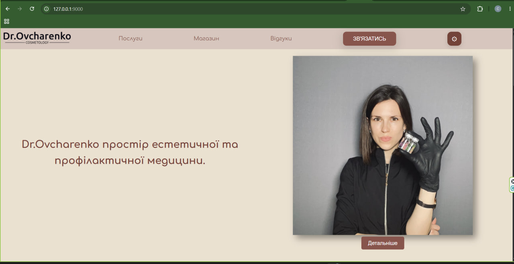
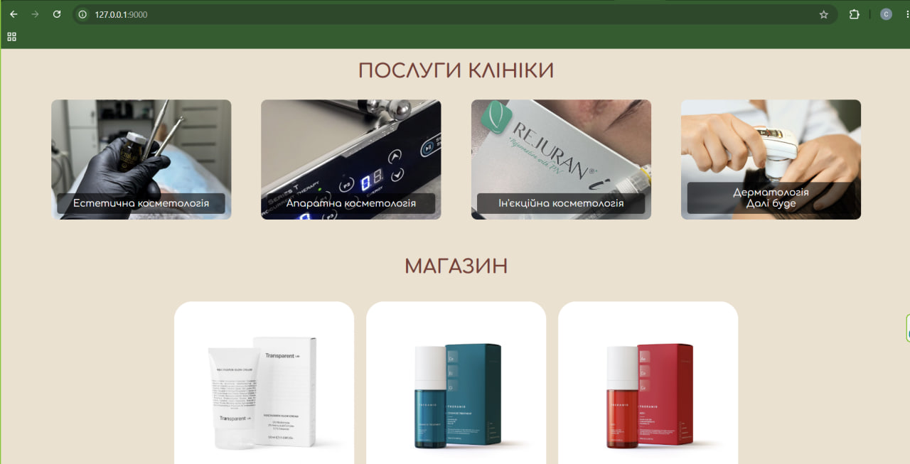
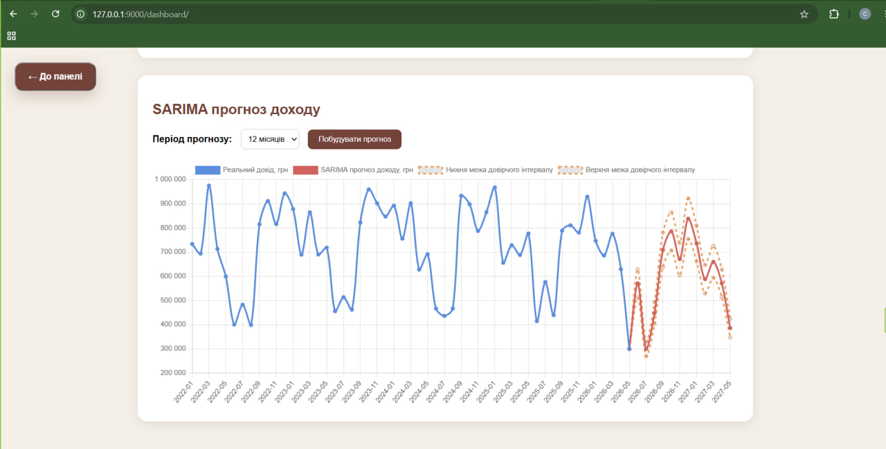
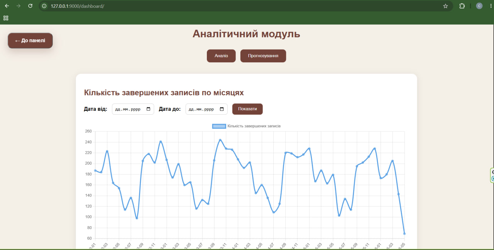
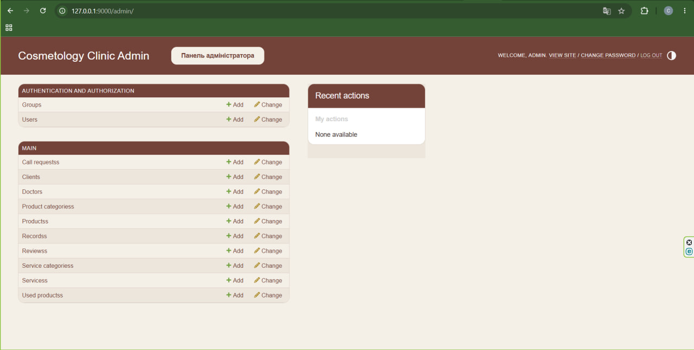
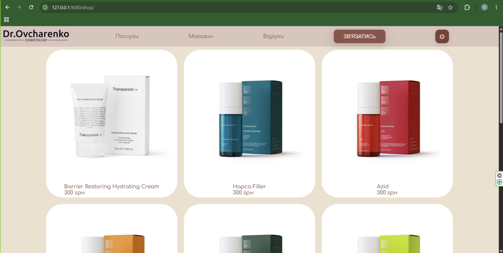

# 💇‍♀️ Cosmetology Clinic Management System

**Cosmetology Clinic Management System** is a web application for a cosmetology clinic, built with **Django** and **PostgreSQL**. The project combines a public-facing clinic website with dynamic database-backed content management and an administrative analytics dashboard.

---

## 🚀 Key Features

* **Public Clinic Website:**
  * Homepage.
  * Specialist profiles and information.
  * Cosmetology service pages.
  * Product catalogue.

* **Database-Backed Content Management:**
  * Manage services, service categories, products, product categories, specialists, clients, appointments, callback requests, and reviews via Django Models.

* **Review Submission System:**
  * Automatically verifies that a client exists and has a completed appointment before allowing a review submission.

* **Administration Panel:**
  * Customized **Django Admin** interface for managing clinic records, including clients, specialists, services, products, appointments, reviews, callback requests, and used products.

* **Analytics Dashboard:**
  * Interactive charts summarising completed appointments, monthly income, popular services/categories, and client visit frequency by gender and age group.

* **Time-Series Forecasting:**
  * Uses **SARIMAX / SARIMA** models to forecast appointment counts and income (when sufficient historical data is available).

---

## 🛠 Technology Stack

* **Backend:** Python, Django, Django ORM
* **Database:** PostgreSQL
* **Frontend:** HTML, CSS, JavaScript, Django Templates
* **Visualization & Analytics:** Chart.js, pandas, statsmodels

---

## 🔄 How It Works

The entire Django project code is located in the `backend/` directory:

1. A browser sends a page request through a URL configured in `backend/config/urls.py`.
2. Django routes the request to the corresponding view in `backend/main/views.py`.
3. The view queries or updates PostgreSQL through Django ORM and models in `backend/main/models.py`.
4. The view passes the resulting data to a Django template in `backend/main/templates/`.
5. The template renders the page, loading static CSS, JavaScript, and images from `backend/main/static/`.

> **Important:** The application uses an existing PostgreSQL schema. The clinic models in `main/models.py` are set to `managed = False`, so Django migrations do not create or alter application tables. The database schema must be created separately (e.g., by restoring an SQL dump from the companion database repository). Django migrations are only required for Django's internal system tables.

---

## 📊 Analytics & Forecasting

* Access to the analytics dashboard is restricted to authenticated clinic staff members.
* Uses Django ORM queries to aggregate completed appointments and related data from PostgreSQL.
* The **pandas** library prepares monthly time series, and **SARIMAX** builds forecasts (requires at least 24 monthly observations).
* Data is passed from Django to templates

## Interface Preview

  
  
  
  
  
  

